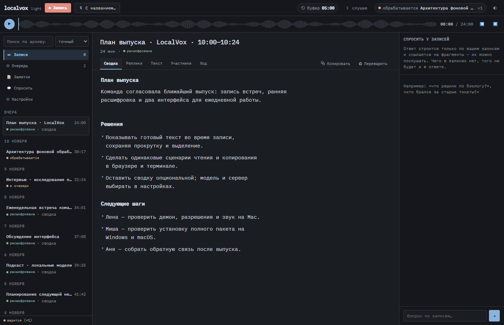
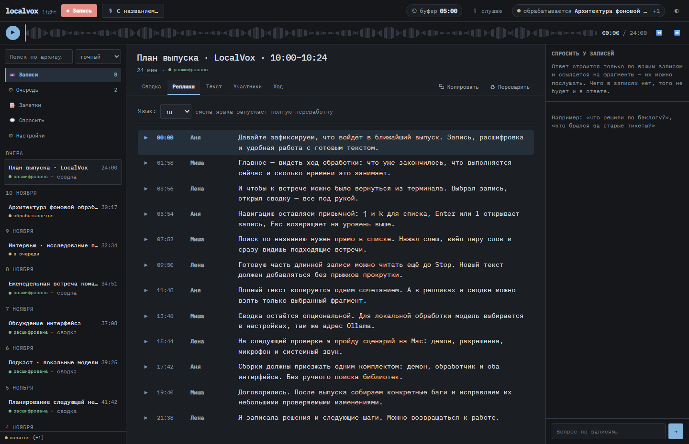
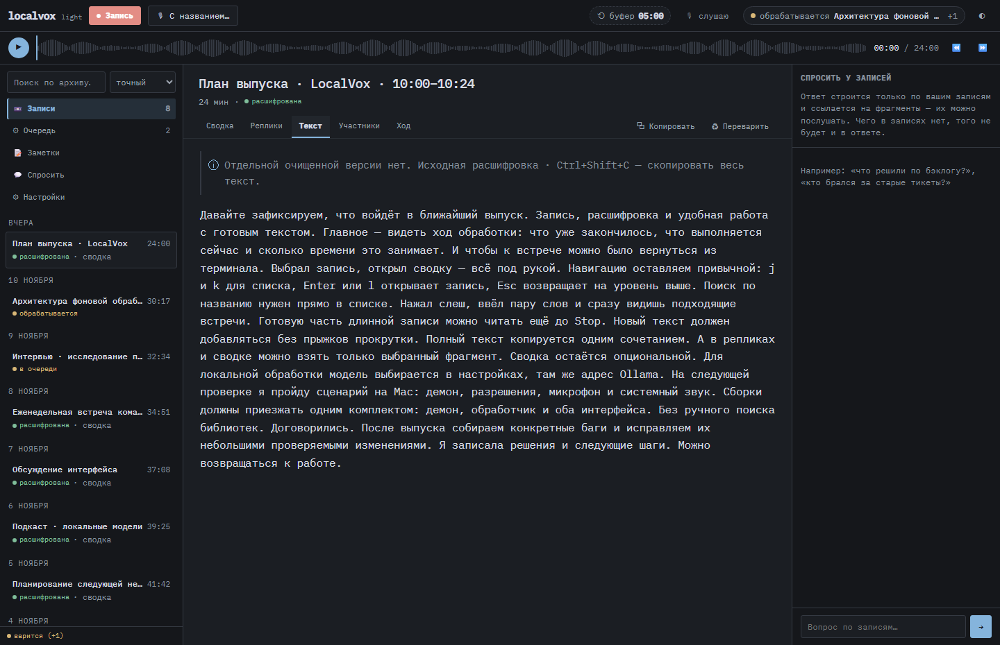
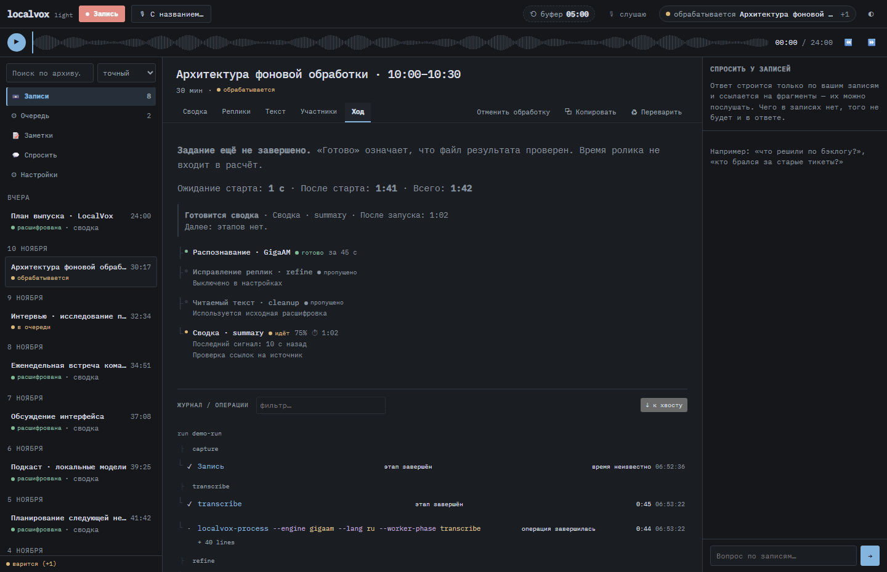
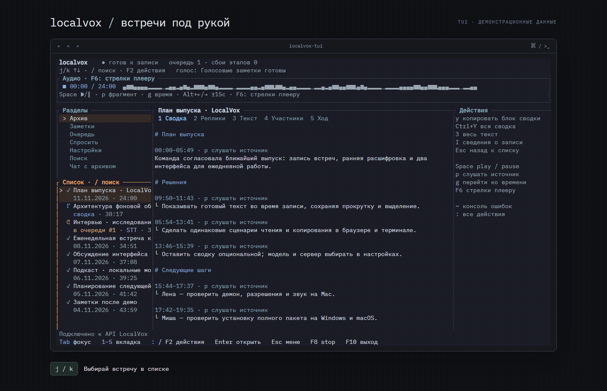
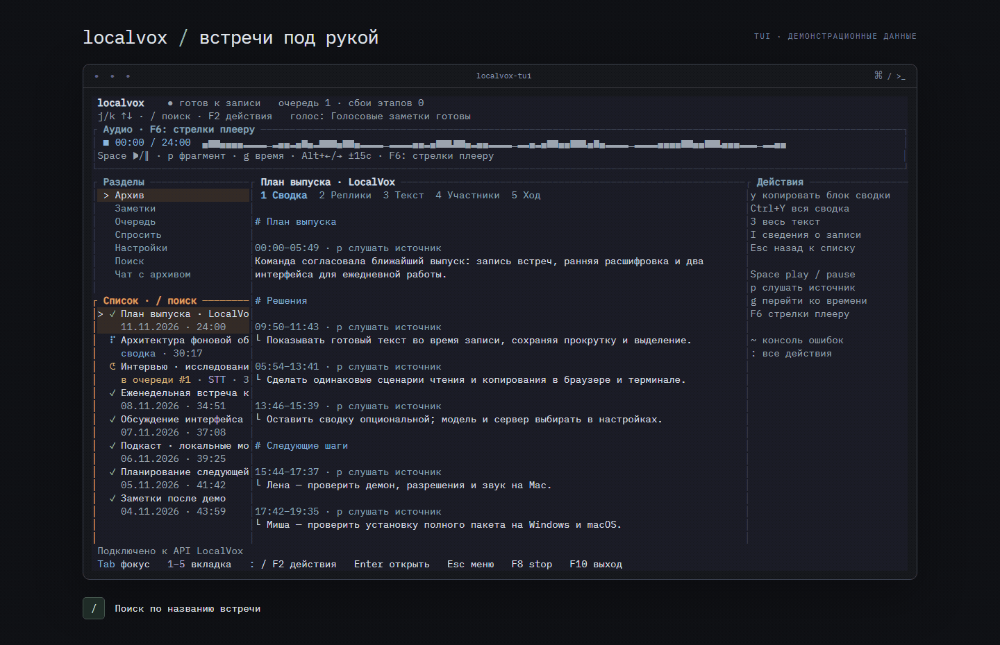
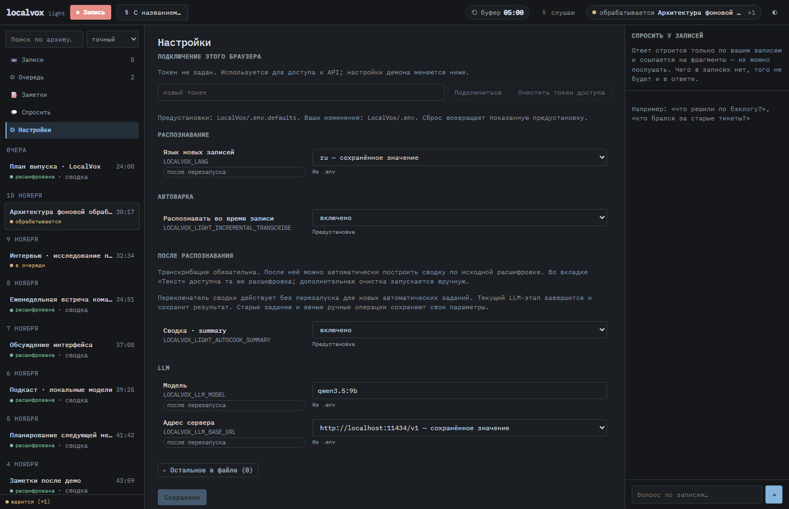

# LocalVox



**Локальный голосовой секретарь для встреч.** Записывает микрофон и системный звук,
расшифровывает разговор и по желанию готовит сводку. После встречи можно найти
нужную реплику, послушать исходный фрагмент и забрать текст.

Один архив доступен в браузере, окне приложения и терминальном TUI. Распознавание
работает локально; для сводки и вопросов можно подключить Ollama или свой LLM-сервер.

<a id="установить-и-запустить"></a>
<a id="как-запустить"></a>

## Установка

Установщик скачает [полный комплект](https://github.com/cascad/localvox-light/releases/latest)
и откроет мастер.

**Windows x64 — PowerShell:**

```powershell
irm https://github.com/cascad/localvox-light/releases/latest/download/install.ps1 | iex
```

**macOS — Apple Silicon / Intel; Linux — x64 / ARM64:**

```bash
curl -fsSL https://github.com/cascad/localvox-light/releases/latest/download/install.sh | bash
```

«Установить всё необходимое» подготовит распознавание,
сводки с локальной Ollama, разметку говорящих, загрузку ссылок и плеер.
В «Выбрать компоненты» — галочки пробелом, переход стрелками и Enter; Esc открывает
возврат назад. Можно указать готовые модели, свой сервер или другой диск.
Перед установкой появится план. Недостающие программы устанавливаются автоматически;
менеджер ОС может запросить системный пароль. Rust, Python, Node и заранее установленный
`jq` не нужны. Повторный запуск сохраняет выбор и использует уже готовое.

Модели по умолчанию хранятся в **`~/.localvox/models`** — на Windows это
**`%USERPROFILE%\.localvox\models`**. В мастере можно выбрать другую папку, например
на другом диске. Уже настроенные пути и модели рядом с программой сохраняются.
Моделями Ollama управляет сама Ollama.

Открой **http://127.0.0.1:3017/**. Для TUI после установки перезапусти терминал
и введи **`vox`**: команда подключится к работающему демону или запустит его сама.
Обычный выход закрывает только TUI. Для полной остановки: F2 → «Завершить LocalVox»
→ Ctrl+S. В комплекте Windows/Mac также есть окно
`localvox-desktop`. Без регистрации PATH можно запускать `.\vox.exe` / `./vox`
из папки установки.

Для загрузки по ссылке нужны `yt-dlp` и `ffmpeg`; для прослушивания в TUI — mpv ≥ 0.38.
Сводка и поиск по смыслу требуют выбранной модели LLM/эмбеддингов.

[Подробная установка, обновление и doctor](docs/release-installation.md) ·
[Сборка из исходников](docs/development.md)

## Читать расшифровку ещё во время встречи

Запись микрофона и системного звука сохраняется по частям. Закрытые фрагменты
распознаются заранее: готовую часть уже можно читать и копировать в UI и TUI.
После Stop приложение завершает оставшийся хвост и собирает результат.

Режим включён по умолчанию при работающей автоварке и отключается в настройках.
Сводка строится после остановки записи; транскрибация остаётся обязательным этапом.

## Сводка, реплики и цельный текст

У каждой встречи есть сводка, реплики с временем и участниками, а также цельный
текст для чтения и копирования. Сводку можно отключить и оставить распознавание.
Имена участников можно поправить внутри записи; приложение не узнаёт людей между встречами.

| Реплики с привязкой к аудио | Цельный текст |
|---|---|
| [](docs/media/gui-transcript.png) | [](docs/media/gui-text.png) |

Из реплики или блока сводки можно перейти к исходному фрагменту. Плеер позволяет
слушать запись и перематывать её, сохраняя связь текста с аудио.

## Видеть, что происходит с обработкой

Раздел «Ход» показывает текущую операцию, её длительность, завершённые этапы и
следующие шаги. Подробные логи раскрываются по требованию. Ошибки видны в журнале;
для неудачного задания доступны повтор и остановка обработки.



Ссылку на YouTube можно отправить на обработку из UI/TUI. Несколько встреч проходят
через очередь; независимые этапы разных записей могут выполняться параллельно.
Локальный аудио- или видеофайл импортируется через `localvox-process --ingest <файл>`.

## Работать в терминале без мыши

TUI открывает тот же архив: сводку, реплики, текст, участников, ход обработки,
очередь, заметки и настройки. Подсветка показывает активную панель; подсказки
действий находятся рядом с документом.



`j/k` или стрелки выбирают запись, `l` / Enter открывает её, `1–5` меняют вкладку,
Esc возвращает на уровень выше. `y` копирует выбранную реплику или блок сводки,
а во вкладке «Текст» — весь текст. F2 открывает список действий.

В списке `/` включает фильтр по названию — результат меняется по мере ввода:



Есть управление плеером с клавиатуры, светлая и тёмная темы, изменение ширины списка
и собственные привязки клавиш. [Клавиши и запуск TUI](docs/terminal-workspace.md).

## Искать и задавать вопросы архиву

Поиск работает по тексту записей. Для поиска по смыслу и гибридного режима
подключаются эмбеддинги. «Чат с архивом» ищет подходящие фрагменты и использует
их в ответе со ссылками на реплики, которые можно прослушать.

В отдельном разделе «Спросить» можно передать свой текст или текстовый файл и
вернуться к сохранённому ответу. Это отдельный сценарий от вопросов по встречам.

## Настраивать модели и работу приложения

В настройках видны предустановленное значение, своё переопределение и момент
применения. Можно выбрать LLM-сервер, модель, источники звука и обработку после
распознавания. Для каждой настройки показано, нужен ли перезапуск.

[](docs/media/gui-settings.png)

Проверка готовности без установки и изменения файлов:

```powershell
.\localvox-light.exe --setup-check
```

На Mac/Linux — `./localvox-light --setup-check`. Повторная настройка — `--setup`;
структурированная диагностика для скриптов — `--doctor --doctor-json`.

## Заметки и интеграции

- Сохранять заметки в выбранные разделы и открывать их в UI/TUI.
- Настроить голосовые команды для заметок и управления встречей.
- Подключить архив к агенту через stdio MCP: поиск, чтение записей и добавление заметок.

[Все пользовательские сценарии](docs/user-guide.md) ·
[Интеграции](docs/integrations.md)

## Документация и материалы

На изображениях — настоящие интерфейсы и вымышленные демонстрационные встречи.
Это показ работы приложения, а не пример качества распознавания конкретной модели.

- [Галерея скриншотов и GIF](docs/promo.md) и [промоматериалы](promo/README.md).
- [Архитектура и модульные границы](docs/modularity.md).
- [Сборка и разработка](docs/development.md).
- [Контракт поведения OpenSpec](openspec/README.md), [покрытие и проверки](openspec/evidence/coverage.md),
  [известные ограничения](openspec/review.md).

В GitHub Actions настроены сборки для Windows и macOS (Intel и Apple Silicon).
