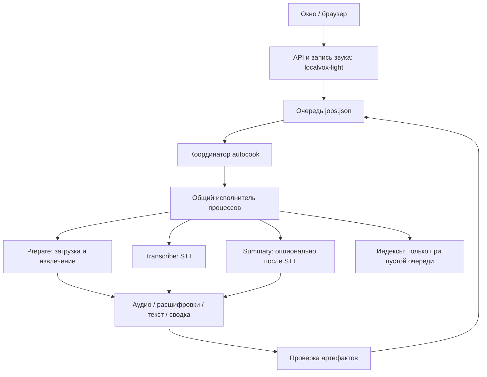

# Архитектура исполнения LocalVox

Черновое описание по коду: [пайплайн PIPE](../openspec/specs/processing-pipeline/spec.md). Проверки и известные
расхождения: [приёмка](../openspec/evidence/pipeline.md), [бэклог](../openspec/backlog.md).

Описание исполнения сверено с кодом 11 ноября 2026. Детали фаз и статусов — в
[описании PIPE](../openspec/specs/processing-pipeline/spec.md); разбор медленного видео и логи — в
[processing-pipeline.md](processing-pipeline.md).

## Решение

Одно приложение в поставке, один координатор очереди, ограниченное число изолированных
обработчиков. Обработчик — обычный дочерний процесс с явно заданным владельцем,
протоколом, фазой, сроком исполнения и проверяемым результатом. `subprocess` сам по себе
не является проблемой; проблема — процесс без этих правил.



Штатная автоматическая цепочка: Prepare для ссылки → обязательный Transcribe →
опциональный Summary. Без правки текста читаемое представление берётся из первичной
расшифровки. Text/refine/cleanup остаются совместимыми фазами старых заданий и
явными CLI-операциями; автоматическая цепочка их не добавляет.

Все рабочие роли запускает `localvox-process`; отдельный бинарник для каждого этапа
не нужен. Сейчас поставляются основной процесс и этот обработчик. ONNX остаётся
зависимостью обработчика; запись и API не должны загружать модель ради сводки.
Один установщик/ярлык сохраняет удобство пользователя. Буквально один EXE тоже может
запускать себя в разных режимах, но здесь это смешало бы зависимости записи и ONNX,
не дав выигрыша в надёжности.

## На какие существующие решения опираемся

* [Electron utility processes](https://www.electronjs.org/docs/latest/tutorial/process-model):
  тяжёлая и потенциально аварийная работа отделена от главного процесса; её жизненным
  циклом управляет главный процесс. Переносим принцип владения, а не Electron.
* [Tauri sidecars](https://v2.tauri.app/develop/sidecar/): дополнительные исполняемые
  файлы можно включать в поставку одного desktop-приложения.
* [process-wrap](https://github.com/watchexec/process-wrap): готовые Windows Job Object
  и Unix process group вместо собственной реализации управления деревьями через FFI.
* [Temporal Activity Execution](https://docs.temporal.io/activity-execution): выполнение
  может повториться после сбоя, поэтому завершение и повтор должны иметь явный контракт.
  Используем этот принцип; сервер Temporal для локального приложения не добавляем.
* [SQLite для локальных приложений](https://www.sqlite.org/whentouse.html) подходит для
  транзакционной очереди. Сейчас миграция не исправила бы владение процессами, зависание
  pipe и ложное завершение. Оставляем одного писателя `jobs.json` с атомарной публикацией.
  Если появятся несколько координаторов или история сделает полное чтение очереди дорогим,
  SQLite станет естественной заменой хранилища очереди. Сами медиа останутся файлами.

## Границы в коде

| Компонент | Единственная основная ответственность |
|---|---|
| `localvox-light/src/main.rs` | Запуск приложения, запись, API и интерфейс |
| `localvox-light/src/autocook.rs` | Конфигурация исполнения, выдача фаз, ограничение параллелизма, принятие результата |
| `localvox-light/src/autocook/execution.rs` | Команда worker, resident/one-shot transport, heartbeat и исход исполнения; без переходов очереди |
| `localvox-light-asr/src/prepare` | Ручной и queued import policies; общий PCM recorder и настройки media tools |
| `localvox-light-core/src/asr/package.rs` | Конкретная ASR-модель, зависимости и загрузка; cook сохраняет проверки identity |
| `localvox-light-llm/src/backend` | Messages/options → raw content/error через HTTP/Ollama/CLI; общий клиент проверяет ответ |
| `localvox-light-process` | Запуск, владение деревом ОС, таймаут, отмена, ограниченная диагностика |
| `localvox-light-asr/src/bin/localvox-process.rs` | CLI и диспетчер операций обработчика |
| `localvox-light-asr/src/prepare.rs` | Заполнение существующей сессии аудио из ссылки |
| `core/jobs.rs` | Состояние очереди, переходы фаз, ограниченные повторы |
| `core/artifacts.rs`, `processing.rs` | Проверка и подтверждение сохранённых результатов |
| `core/progress.rs`, `workflow.rs` | События операций и представление состояния для UI |
| `llm/claude_cli.rs` | Параметры и формат ответа Claude; исполнение делегируется общему модулю |

## Правила исполнения

1. При запуске координатор получает снимок окружения, пути, провайдера и лимиты.
   До захвата заданий выполняет `--worker-protocol`; несовместимая пара бинарников
   даёт явную ошибку preflight и не меняет очередь. После изменения настроек нужен
   перезапуск координатора.
2. Один владелец на сессию: `.worker.lock` удерживается от захвата фазы до приёмки
   результата. Ручной CLI и API повторной обработки используют тот же замок.
   Отсутствие heartbeat не позволяет перехватить живую работу и удалить её файлы.
3. `--worker-phase prepare|transcribe|text|summary` выполняет ровно указанную фазу.
   Выход с кодом 0 ещё не означает `Done`: координатор проверяет артефакт и лишь
   затем сохраняет переход очереди. Текст stderr объясняет ошибку, но не управляет переходом.
4. Для новых загрузок сначала атомарно пишется `prepare.json` с `complete: false`.
   После сохранения всего декодированного аудио записываются число сэмплов и SHA-256
   файлов, затем `complete: true`. Падение после первого чанка не подтверждает весь ролик.
   Приёмка и повтор проверяют контрольные суммы. UI проверяет манифест, заголовки и размеры,
   чтобы каждый опрос не перечитывал гигабайты аудио. Старые архивы без этой квитанции
   сохраняют прежнюю структурную проверку; это не доказательство исторической полноты.
5. На остановку приложения, таймаут и ошибку исполнения останавливается дерево процесса.
   На Windows Job Object с kill-on-close защищает также от аварийной смерти координатора.
   Обычный выход обработчика тоже убирает оставшихся потомков. Unix process group покрывает
   управляемую остановку; гарантия очистки при `SIGKILL` самого координатора здесь не заявлена.
6. Stdin/stdout/stderr используют временные файлы: нет взаимной блокировки pipe и потоков,
   бесконечно ждущих EOF от потомка. Вывод в памяти ограничен 8 MiB на поток; рост файлов
   проверяется каждые 100 мс. Это наблюдаемый порог остановки, а не дисковая квота.
   В журнале во время работы видны безопасные факты о доставленном выводе, а не его
   содержимое; подробная диагностика остаётся у обработчика. Текущая работа видна
   по `progress.jsonl` и heartbeat координатора каждые 15 секунд. Resident ASR
   использует отдельный bounded stdin/stdout request/reply, описанный ниже.
7. Индексация тоже исполняется в контролируемом процессе. Запускается после освобождения
   очереди, отменяется при появлении задания, имеет отдельный таймаут. Ошибка индекса
   не откатывает расшифровку и не переводит готовую запись в незавершённую.

## Отмена и изменения записи

API сначала получает неблокирующий `.mutation.lock`, затем `.capture.lock` и
`.worker.lock`. Capture lease удерживают recorder и принадлежащие ему конвертеры,
в том числе после исчезновения маркера записи. Удаление отказывает до изменения
очереди, пока первичные файлы ещё сохраняются.
Обычные recook/best/lang/имена отказывают до записи, если сессия занята. Отмена и
удаление сохраняют `Cancelling`, затем сигналят зарегистрированному в этом daemon
владельцу конкретного execution; сторонний CLI получает объяснимый отказ.
Подтверждение требует реального освобождения `.worker.lock` и сохранения `Cancelled`.
Истечение ожидания или отсутствие heartbeat не заменяет освобождения.

Supervisor останавливает принадлежащее дерево; готовые результаты сохраняются,
непроверенные не становятся готовыми. Отменённое задание не захватывается повторно
после рестарта: продолжение явное и с той же фазы. Удаление после остановки держит
оба lease, удаляет каталог и затем очищает очередь. При таймауте остановки
отложенного удаления нет. Ошибка физического удаления может оставить неполный
каталог, но fence не позволяет автоматически запустить его заново.

## Подтверждение первичного аудио

Новые записи объявляют UUID `capture_generation` в `meta.json` и ведут атомарный
`capture/state.json` (version 1). Единственный capture writer публикует revision,
источники 0/1 и непрерывные диапазоны в целых сэмплах: sequence, start_sample,
samples, outcome (`audio`, `empty`, `unknown`). Открытый диапазон не готов к чтению.
Ошибка записи/patch/sync/rename не подтверждает аудио; `.part` сохраняется.
Пустой диапазон подтверждается до удаления пустого `.part`.

Pause закрывает текущие файлы, сохраняя generation и аудиошкалу. Stop сначала
закрывает хвосты обоих источников и затем публикует terminal с точными концами.
Без terminal обычный full cook/discovery не принимает новую запись. Отсутствующий
или повреждённый manifest новой записи не включает legacy fallback. Архивы без
capture marker используют прежний путь. Ранний ASR подключён отдельным опциональным
сценарием, описанным ниже; по умолчанию он выключен.

После получения workspace ownership recovery дополнительно получает capture lease.
Оно проверяет сохранённое аудио, восстанавливает meta и публикует interrupted EOF
только при учёте всех файлов и диапазонов. Известный потерянный диапазон нельзя
укоротить до выживших байтов. Неполный PCM-сэмпл и неизвестный хвост блокируют EOF;
несохранённые до сбоя устройства/питания сэмплы не объявляются восстановленными.

Чтение и WAV→FLAC используют общий logical chunk lease в `.audio-locks/` независимо
от расширения и нулей в sequence. Читатель держит shared lease, конвертер — exclusive;
представление выбирается после захвата, WAV имеет приоритет. Конвертер запускается
через process supervisor: общий deadline 120 s, отмена при shutdown, один активный
и не более одного ожидающего задания. При занятости остаётся WAV.

До удаления WAV проверяются полный strict decode, точное число и SHA-256 PCM,
sync FLAC и атомарная квитанция `audio-codecs/` с generation/PCM/container digest.
Повторная проверка WAV предшествует удалению. Ошибка на любом шаге сохраняет исходник.
PCM читается блоками 64 KiB; для FLAC декодирование ограничено временем/размером и
использует временный PCM на диске аудио, без полной копии чанка в памяти.
Проверки и границы — [capture evidence](../openspec/changes/add-incremental-recording-transcription/evidence/capture-input.md).

Общий `core/windowing.rs` доступен capture без ONNX. Offline cook и benchmark
используют тот же `Windower` через совместимый re-export. `feed_all` выдаёт закрытые
speech/silence диапазоны, `feed` — прежний speech-only ASR вход; переносимая
граница файла не flush. В памяти остаются только текущее окно и неполный 20 ms frame,
`finish_all` вызывается только для EOF и повторяется без дублирования. Отказ sink
требует replay сохранённого PCM; повреждённый planner не продолжает с догадками.
Рецепт VAD/quietest cut не менялся: [побайтовые проверки](../openspec/changes/add-incremental-recording-transcription/evidence/window-planner.md).

Capture теперь владеет отдельным лёгким потоком `capture-plan`. Он создаёт native
VAD внутри потока, читает только новые sealed ranges и публикует immutable descriptors
с PCM SHA и speech/silence outcome до атомарного `capture/plan/state.json`.
В state — capture revision, recipe, per-source input/closed bounds и общий минимум
неоконченных источников. Источник без данных, unknown или отстающая дорожка не
считаются тишиной; при неясной топологии общий префикс может ждать до EOF.

Recorder посылает только coalesced wakeup (канал ёмкостью один), без PCM и ожидания
планировщика. Idle timeout проверяет отмену, не перечитывает диск. В штатном проходе
закрытый файл читается один раз; VAD/tail остаются в RAM, не сериализуются. Replay
возможен после сбоя, но не при каждом обновлении. Окно ограничено recipe, decoder
читает блоками 64 KiB; временный decoded FLAC лежит на диске аудио.

Stop подтверждает primary EOF независимо от планировщика; drop session handle
передаёт последний дисковый horizon без join на пути записи. Планировщик удерживает
capture lease до выхода. Engine manager владеет максимум двумя потоками (предыдущая
и текущая запись); при занятости первичное аудио сохраняется для полной обработки.
Shutdown отменяет чтение/decoder и join-ит принадлежащие потоки. Отказ планировщика
пишется в capture-журнал, primary recording продолжается. Сам планировщик не
запускает ASR/LLM и не пишет версии/best/summary: finite horizon обрабатывает
координатор, а подтверждённый префикс читают UI/TUI через API.
Проверки: [capture planner](../openspec/changes/add-incremental-recording-transcription/evidence/capture-planner.md).

STT cache library (`core/incremental`) проверяет finite horizon и actual model/vocab
fingerprints. `VerifiedWindow` сверяет count/PCM SHA; result записывается и
перечитывается до checkpoint. Speech/Empty/Silence — разные успешные outcomes,
ошибка не закрывает покрытие. Checkpoint содержит per-source frontiers и отдельный
publication watermark для устойчивого порядка окон и доступного аудио. Повреждённый
suffix не удаляет независимые валидные результаты. Писатель вызывается под processing
execution ownership (standalone CLI или supervising coordinator), как VersionStore.
Сам cache не пишет best/версии/полные receipts и не разрешает summary.
[Проверки кеша](../openspec/changes/add-incremental-recording-transcription/evidence/asr-cache.md).

Transcribe-линия использует один управляемый stdio worker: общий handshake
`localvox-worker/3`, resident request/reply `localvox-asr/1`.
порции и финал идут последовательно через bounded request/reply с protocol/id.
Одна ASR-модель остаётся в нём до 600 секунд простоя; настройка
`LOCALVOX_ASR_KEEP_ALIVE_SEC=0` возвращает одноразовые запуски. На каждом запросе
проверяется полный content fingerprint; другой engine заменяет прежний. Простой не
удерживает запись или её execution lease. Cancel/timeout/protocol error/shutdown
завершают дерево процесса. Daemon и worker обновляются одним комплектом.

Производные результаты окон сохраняются в ограниченных framed journal segments
`incremental/<identity>/results/*.wal`: каждый результат синхронизирован до принятия,
header/payload проверяются по SHA. Незавершённый или повреждённый frame не закрывает
покрытие; следующие целые результаты восстанавливаются. Старые `windows/*.json`
читаются без массовой миграции. Проверенный batch живёт только внутри одной операции;
между запросами authoritative cache перечитывается. Частичный текст публикуется
после checkpoint; final повторно проверяет PCM и использует готовые окна.
Остановка внешнего Ollama и общая crash-транзакция нескольких файлов не обещаются.
[Проверки](../openspec/changes/archive/2026-11-01-serialize-session-mutations/evidence/implementation.md).

## Лимиты

Это предельное время попытки, а не прогноз продолжительности. Большой лимит допускает
длинные записи; диагностика внутри этапа показывает, где фактически потрачено время.

| Переменная | По умолчанию |
|---|---:|
| `LOCALVOX_PREPARE_TIMEOUT_SEC` | 1800 |
| `LOCALVOX_TRANSCRIBE_TIMEOUT_SEC` | 7200 |
| `LOCALVOX_TEXT_TIMEOUT_SEC` | 7200 |
| `LOCALVOX_SUMMARY_TIMEOUT_SEC` | 1800 |
| `LOCALVOX_INDEX_TIMEOUT_SEC` | 300 |
| `LOCALVOX_CLAUDE_TIMEOUT_SEC` — один запрос внутри сводки | 300 |

В логе фазы есть `job_id`, `session`, `phase`, `attempt`, PID, прошедшее время,
лимит, последняя операция и причина остановки. В `progress.jsonl` остаются операции
и фактические счётчики. В файлах результатов остаётся сама выполненная работа.

## Проверки и дальнейшие границы

```powershell
cargo test -p localvox-light-process
cargo test -p localvox-light-core -p localvox-light-api -p localvox-light-llm --lib
cargo test -p localvox-light --bin localvox-light
cargo build -p localvox-light -p localvox-light-asr --bin localvox-light --bin localvox-process
python scripts/check-pipeline.py
```

Процессные тесты используют настоящие процессы: заполнение stdout до чтения большого
stdin, отмена, таймаут, оставшийся потомок после успешного выхода родителя, лимит вывода,
ошибка запуска и аварийная смерть владельца Windows Job Object. Проверки очереди/артефактов
покрывают отсутствие результата, повреждение, частичную загрузку и отказ от повторного
стирания при живом владельце. Smoke-проверка использует временный архив и локальную
подставную LLM: протокол, изоляция текстовой фазы, heartbeat, повтор без генерации.

Это рефакторинг контура фоновой обработки, а не объявление всей кодовой базы законченной.
Следующие самостоятельные задачи: разделить большой CLI по операциям без изменения
протокола; декодировать длинное аудио потоком вместо накопления PCM в памяти; унифицировать
ручной импорт и фоновый Prepare; распространить владение сессией на остальные изменяющие
операции API. Отдельные постоянные STT-сервисы оправданы после измерения стоимости
повторной загрузки модели — сейчас они добавили бы состояние и восстановление соединений.

Параллелизм убирает простой разных записей, но не обещает ускорения одного LLM-запроса.
Реальную пропускную способность нужно измерять на release-сборке с выбранными моделями.
