# LocalVox — скриншоты и GIF

Настоящие GUI и TUI, вымышленные демонстрационные встречи. Тексты не получены из
личных записей; это показ интерфейса и навигации, а не оценка качества модели.
PNG — 1440 × 930, GIF — того же размера. Можно брать файлы из [media](media/)
для README, публикаций, презентаций и демонстраций. Нажатие на кадр открывает оригинал.

## Короткие демонстрации

| Файл | Что показывает | Время |
|---|---|---|
| [GUI: работа с записью](media/gui-reading.gif) | Сводка → реплики → цельный текст → участники | 9 с |
| [GUI: журнал обработки](media/gui-workflow.gif) | Этапы, длительности, цветные аргументы, раскрытие и сворачивание логов | 10 с |
| [TUI: без мыши](media/tui-navigation.gif) | `j/k` → `l` → вкладки → `Esc`, подсветка активной области | 12 с |
| [TUI: быстрый поиск](media/tui-search.gif) | `/`, фильтрация по мере ввода, `Esc`, открытие результата | 9,6 с |

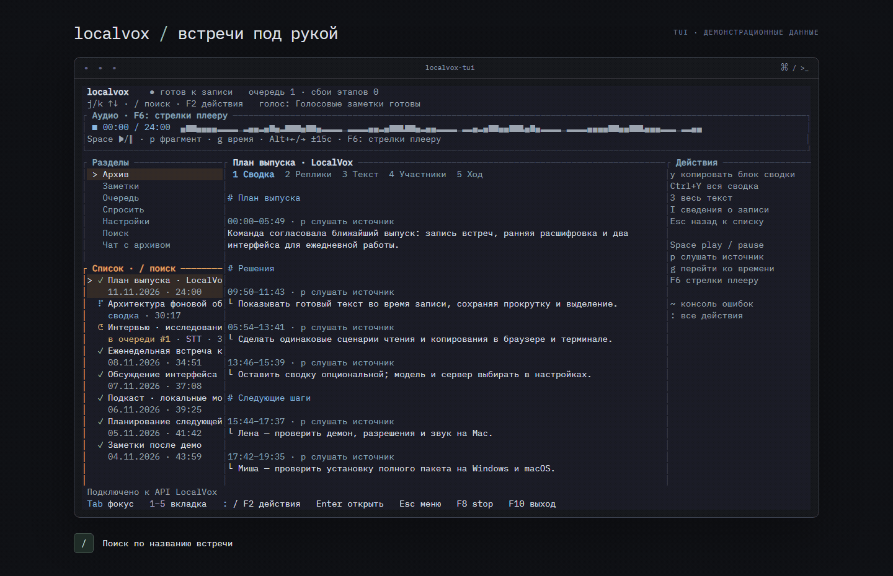

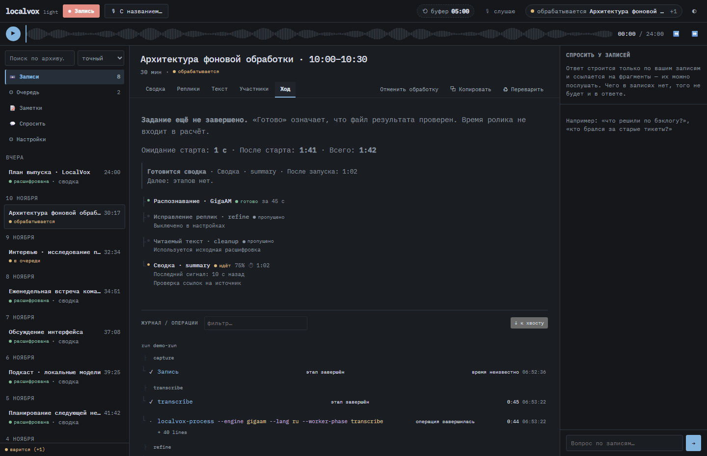

## Графический интерфейс

| Сводка | Реплики |
|---|---|
| [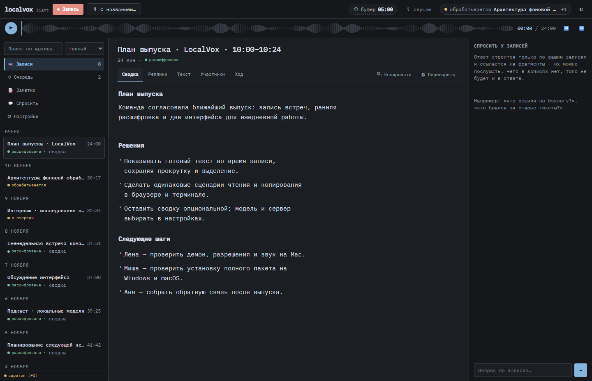](media/gui-summary.png) | [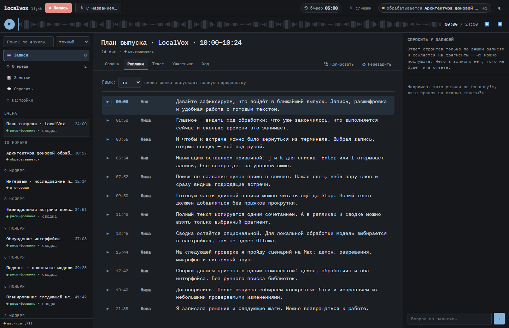](media/gui-transcript.png) |

| Цельный текст | Журнал |
|---|---|
| [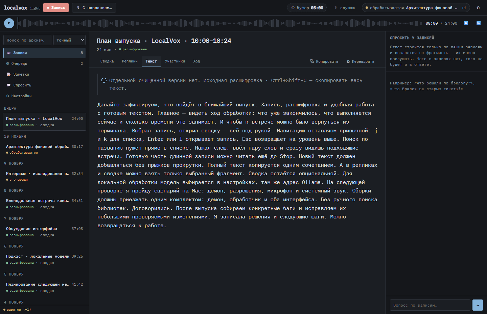](media/gui-text.png) | [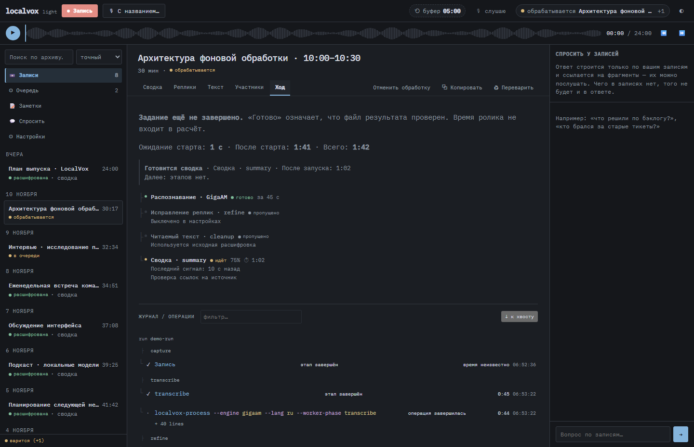](media/gui-journal.png) |

| Настройки | Светлая тема |
|---|---|
| [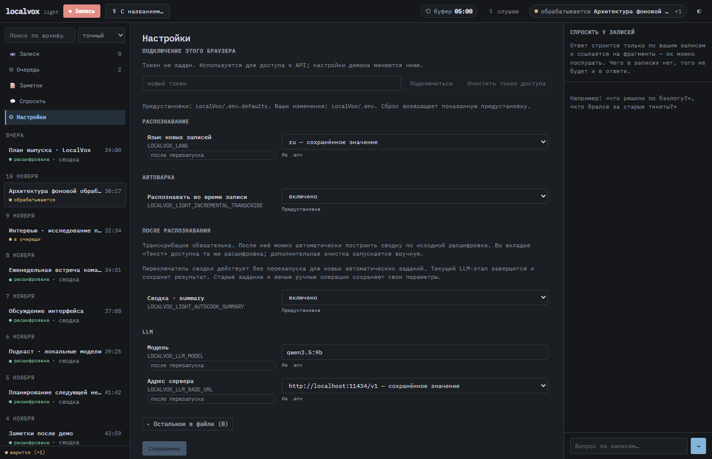](media/gui-settings.png) | [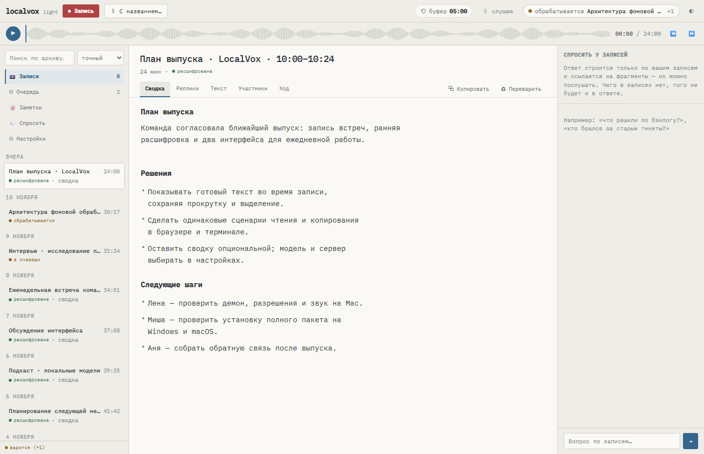](media/gui-light.png) |

## Терминальный интерфейс

| Архив | Сводка |
|---|---|
| [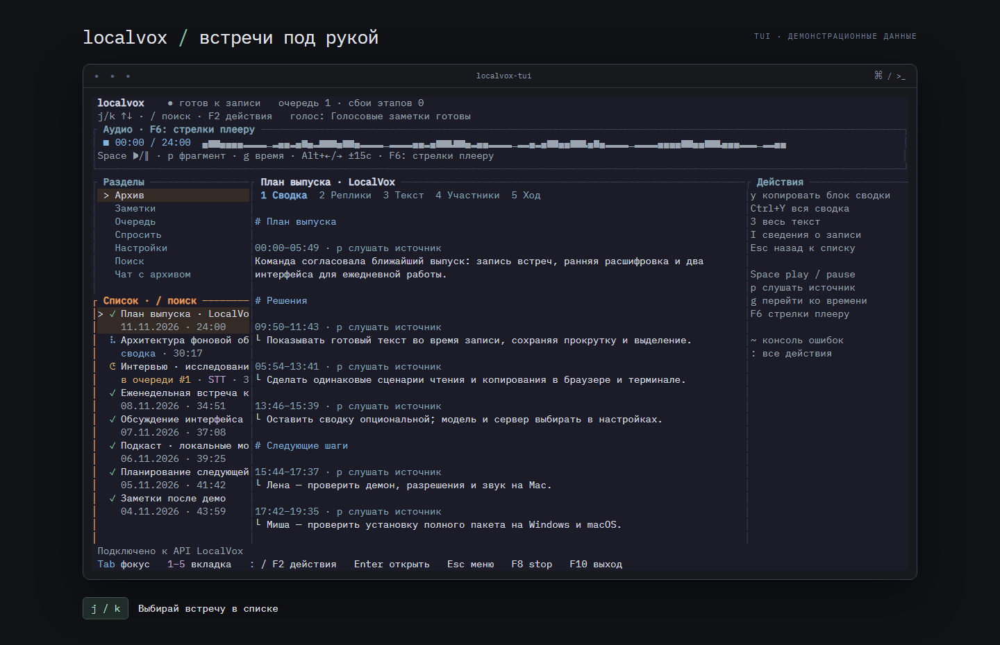](media/tui-archive.png) | [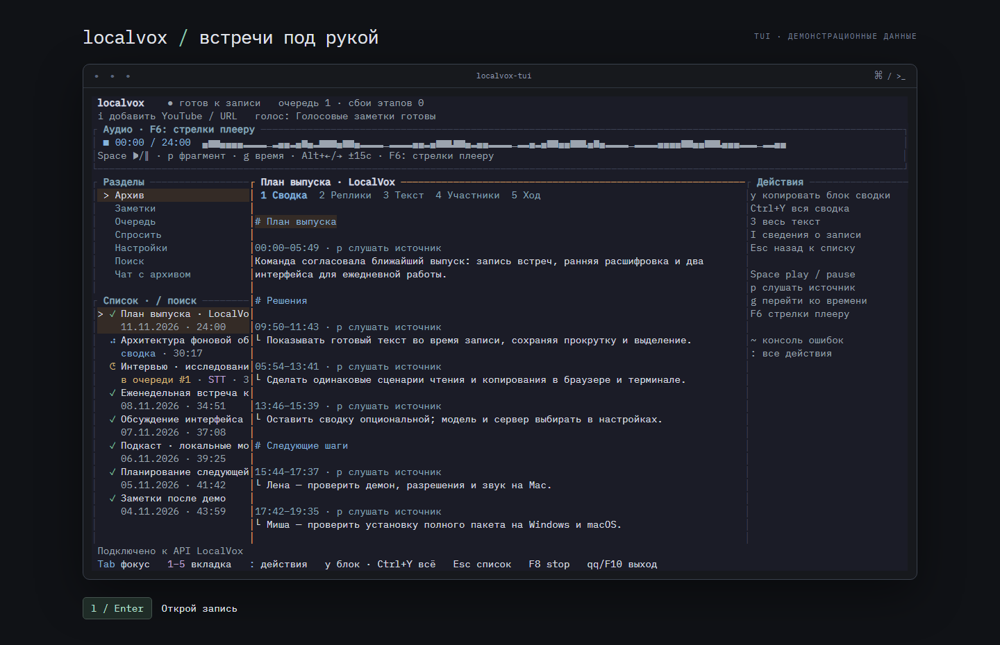](media/tui-summary.png) |

| Реплики | Цельный текст |
|---|---|
| [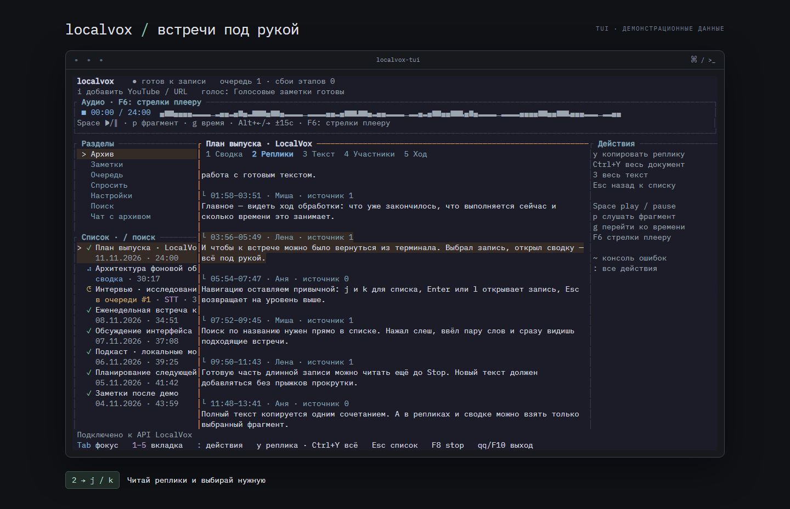](media/tui-transcript.png) | [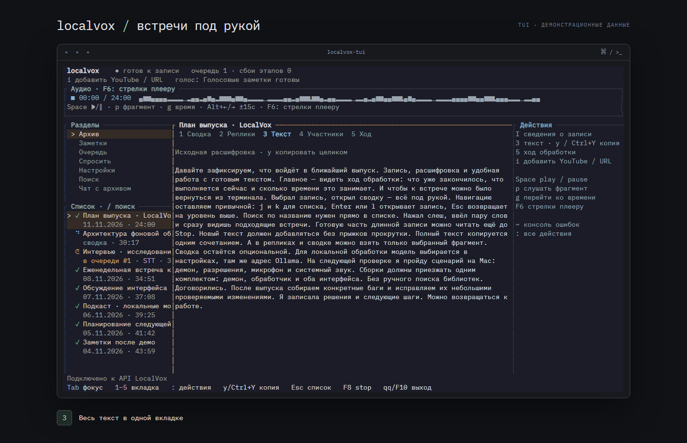](media/tui-text.png) |

[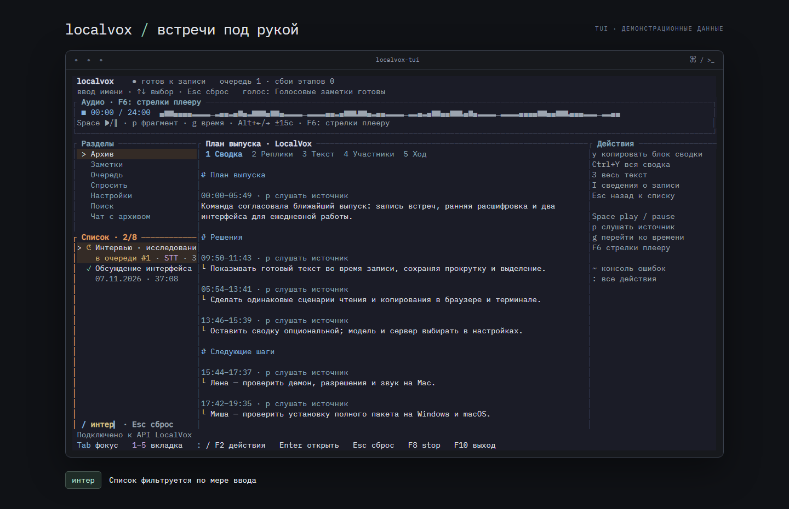](media/tui-search.png)

## Переснять

Из корня репозитория, при установленных Rust, Node и ffmpeg/ffprobe:

```powershell
$env:TEMP="$PWD\target\tmp"; $env:TMP=$env:TEMP
npm.cmd --prefix ui ci
npm.cmd --prefix ui run build
npm.cmd --prefix ui exec -- playwright install chromium
cargo build --locked -p localvox-light-terminal --bin localvox-tui --example promo-capture --jobs 2
$env:LOCALVOX_PROMO_TUI="$PWD\target\debug\localvox-tui.exe"
node scripts/promo/capture.mjs
```

На macOS/Linux команды npm без `.cmd`; `LOCALVOX_PROMO_TUI` должен указывать на
собранный `target/debug/localvox-tui`. Запись PTY проверена на Windows; съёмка
на другом хосте не объявляется проверенной этим набором.

`--gui-only` / `--tui-only` переснимают выбранный интерфейс. Сценарии и подписи —
[capture.mjs](../scripts/promo/capture.mjs), данные — [fixture.mjs](../scripts/promo/fixture.mjs).
Для TUI запускается настоящий процесс в PTY, его ANSI-вывод воспроизводится в
обычном эмуляторе терминала. Карточка и подпись клавиш находятся вне приложения.
Для GUI используются собранные React-файлы и обычные клики, без изменения CSS продукта.

Съёмка поднимает отдельный loopback-сервер. Демон, микрофон, рабочая `.env` и
пользовательский архив не нужны. Промежуточные файлы — в `target/promo`, кадры
успешно собранного GIF автоматически удаляются. В Git входят только финальные
PNG/GIF, [manifest с размерами и SHA-256](media/manifest.json) и инструменты съёмки.
